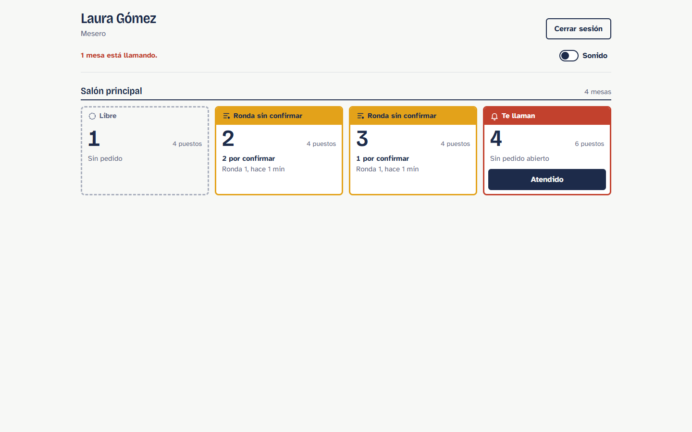
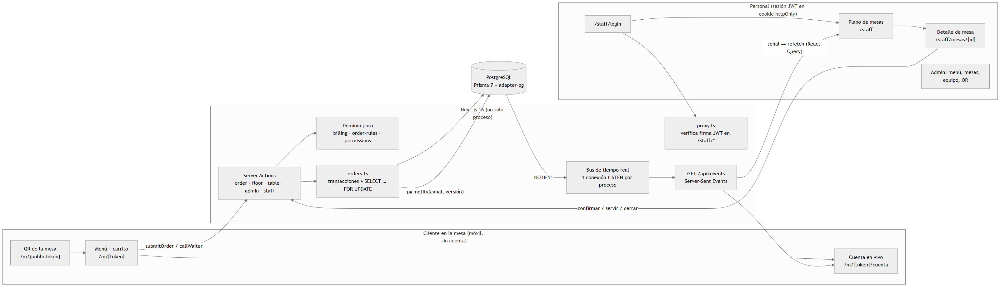

# Mesa Viva

**[English](#english) · [Español](#español)**



**Stack:** Next.js 16 (App Router, Server Actions) · TypeScript · PostgreSQL · Prisma 7 · SSE + `LISTEN/NOTIFY` · TanStack Query · Zod · Vitest · Playwright

---

## English

QR ordering for restaurants. Customers order from their phone without creating an account, and the waiter sees each round on their board in real time.

### How it was built

I built this project with **Claude Code**, an AI coding agent. I defined what to build and set two constraints: customers order without an account, and real time works without external services. The agent wrote the code and the tests from a 13-story PRD in about **2 hours**. Every commit carries the agent's co-author trailer, and the PRD and the run log are in [`claude-loop/archive/`](claude-loop/archive/). I reviewed the generated code and tested every flow by hand, which is how I found the open bug listed under *Known limitations*. **It never had real users.**

### What it does

- **Customer** (`/m/{token}`): menu by category, notes for the kitchen, ordering in rounds, a live bill, and buttons to call the waiter or ask for the bill.
- **Waiter** (`/staff`): floor plan of their tables with real-time alerts; confirm, serve and close with a tip.
- **Admin** (`/staff/admin`): menu, tables, zones, staff and QR codes.

### Architecture in 30 seconds



```
Server Action → transaction (SELECT … FOR UPDATE) → commit → pg_notify
     ↑                                                           ↓
  refetch  ←  SSE /api/events  ←  one shared LISTEN per process
```

- **One open order per table**, enforced by a partial unique index in Postgres (`WHERE status = 'OPEN'`), not by application code. Prisma can't express partial indexes, so it lives in hand-written SQL in the migration.
- **Events carry no prices.** They only say what changed; the browser refetches through an authorized server endpoint.
- **The server computes every price.** Money is stored in cents, and each order item copies the name and price at the time of ordering, so an open bill doesn't change if the menu does.

Full architecture: [`docs/ARQUITECTURA.md`](docs/ARQUITECTURA.md) (Spanish). Data model: [`docs/diagramas/modelo-datos.png`](docs/diagramas/modelo-datos.png).

### Run it locally

Requires Node.js 22+ and a local PostgreSQL (tested with 18). Microsoft Edge or Google Chrome is needed only for the E2E tests. Tested from a clean clone on Windows on 2026-11-01.

```bash
git clone https://github.com/nicho1607/mesa-viva.git
cd mesa-viva

psql -U postgres -c "CREATE DATABASE mesa_viva"
psql -U postgres -c "CREATE DATABASE mesa_viva_test"
psql -U postgres -c "CREATE DATABASE mesa_viva_e2e"

cp .env.example .env   # fill DATABASE_URL, TEST_DATABASE_URL, SESSION_SECRET, PUBLIC_BASE_URL
                       # and add E2E_DATABASE_URL=…/mesa_viva_e2e for the E2E tests
npm ci
npx prisma migrate deploy
npm run db:seed
npm run dev            # http://localhost:3000
```

Generate `SESSION_SECRET` with `node -e "console.log(require('crypto').randomBytes(32).toString('base64'))"`.

Each table has a random token. List them with:

```bash
psql -U postgres -d mesa_viva -c "SELECT number, \"publicToken\" FROM \"Table\" ORDER BY number"
```

Then open `http://localhost:3000/m/<publicToken>` (phone or mobile view), or download the QR codes from **Admin → QR**.

Demo users (development only): `admin@mesaviva.co` / `admin123` · `laura@mesaviva.co` / `mesero123` (tables 1–4) · `andres@mesaviva.co` / `mesero123` (tables 5–8).

### Tests

| Command | What it runs | Last result (local, 2026-11-01) |
|---|---|---|
| `npm run typecheck` | `next typegen` + `tsc` | no errors |
| `npm test` | Vitest, unit + integration against `TEST_DATABASE_URL` | 201 / 201 in 13.9 s |
| `npm run test:e2e` | Playwright: full customer + waiter flow, concurrency, permissions. Builds, starts on :3300 and **wipes `E2E_DATABASE_URL`** on every run | 5 / 5 |

### Known limitations

- **Open bug:** the customer's bill doesn't always switch to "Served" without a reload, even though the server emits the event.
- Needs a long-running Node server for `LISTEN` and SSE, so it doesn't run on serverless.
- Rate limiting is in memory, including staff login (10 attempts per account per 15 minutes, 100 total per minute, per process).
- No CI and no deployment yet.

---

## Español

Despliegue público de prueba: [guía de Render](docs/DESPLIEGUE_RENDER.md) y configuración automática en `render.yaml`.

Pedidos desde la mesa por QR para restaurantes. El cliente pide desde su móvil sin crear cuenta y el mesero recibe cada ronda al instante en su tablero.

### Cómo lo construí

Construí este proyecto con **Claude Code**, un agente de programación. Yo definí qué construir y puse dos restricciones: el cliente pide sin crear cuenta, y el tiempo real funciona sin servicios externos. El agente escribió el código y los tests a partir de un PRD de 13 historias, en unas **2 horas**. Cada commit lleva su firma de coautor, y el PRD y el registro de la ejecución están en [`claude-loop/archive/`](claude-loop/archive/). Yo revisé el código generado y probé cada flujo a mano; así encontré el error abierto que aparece en *Limitaciones conocidas*. **No tuvo usuarios reales.**

### Qué hace

- **Cliente** (`/m/{token}`): menú por categorías, notas para cocina, pedido por rondas, cuenta en vivo, llamar al mesero o pedir la cuenta.
- **Mesero** (`/staff`): plano de sus mesas con alertas en tiempo real; confirmar, servir y cerrar con propina.
- **Admin** (`/staff/admin`): menú, mesas, zonas, equipo y códigos QR.

### Arquitectura en 30 segundos

- **Una orden abierta por mesa**, garantizada por un índice único parcial en Postgres (`WHERE status = 'OPEN'`), no por el código. Prisma no soporta índices parciales, así que vive en SQL escrito a mano dentro de la migración.
- **Los eventos no llevan precios.** Solo dicen qué cambió, y el navegador vuelve a pedir los datos a un endpoint con autorización.
- **El servidor calcula todos los precios.** El dinero se guarda en centavos, y cada ítem copia el nombre y el precio del momento del pedido, así una cuenta abierta no cambia si cambia el menú.

Arquitectura completa: [`docs/ARQUITECTURA.md`](docs/ARQUITECTURA.md).

### Correrlo en local

Requiere Node.js 22+ y PostgreSQL local (probado con la 18). Los comandos son los de la sección en inglés. Copia `.env.example` a `.env`, completa `DATABASE_URL`, `TEST_DATABASE_URL`, `SESSION_SECRET` y `PUBLIC_BASE_URL`, y agrega `E2E_DATABASE_URL` para las pruebas E2E. Usuarios de ejemplo: `admin@mesaviva.co` / `admin123`, `laura@mesaviva.co` / `mesero123` y `andres@mesaviva.co` / `mesero123`.

### Pruebas

`npm run typecheck` (sin errores) · `npm test` (201 / 201 en 13,9 s) · `npm run test:e2e` (5 / 5; **borra `E2E_DATABASE_URL`** en cada corrida). Medido en local el 2026-11-01.

### Limitaciones conocidas

- **Error abierto:** la cuenta del cliente no siempre pasa a "Servido" sin recargar, aunque el servidor emite el evento.
- Necesita un servidor Node de larga duración (`LISTEN` y SSE); no funciona en serverless.
- El límite de peticiones está en memoria, incluido el login del personal (10 intentos por cuenta cada 15 minutos y 100 totales por minuto, por proceso).
- Sin CI ni despliegue todavía.
