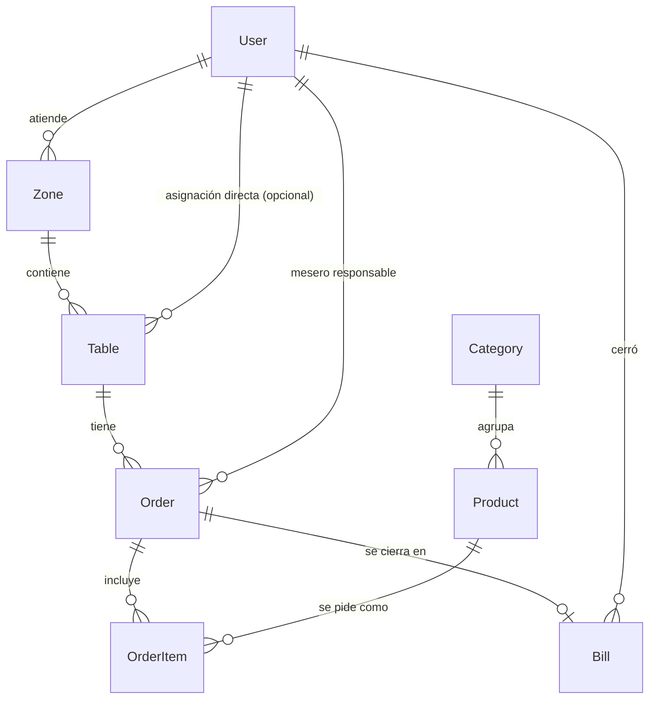

# Mesa Viva — Menú virtual y pedidos en tiempo real

Documento de arquitectura v1 · 2026-10-25

---

## 1. Arquitectura y stack

| Capa | Elección | Por qué |
|---|---|---|
| Framework | **Next.js 15 (App Router) + TypeScript** | Un solo proyecto para cliente, mesero y API. Server Actions para mutaciones, Server Components para el menú (rápido en móvil). |
| UI | **Tailwind CSS v4** + componentes propios | Tokens de diseño en CSS, sin kit genérico. |
| Base de datos | **PostgreSQL 18 local** (`restaurante_sistema`) | Relacional: pedidos, ítems y cuentas son datos transaccionales con integridad referencial. |
| ORM | **Prisma** | Esquema tipado, migraciones versionadas. |
| Tiempo real | **Server-Sent Events + Postgres `LISTEN/NOTIFY`** | Sin servicios extra: la propia BD es el bus de eventos; SSE reconecta solo y atraviesa proxies. Requiere runtime Node (`next start`), no serverless. |
| Auth meseros/admin | **Sesión propia**: bcrypt + cookie httpOnly firmada con `jose` | Pocas cuentas, sin proveedor externo. |
| Auth cliente | **Token de mesa en el QR** (sin cuenta) | El cliente no se registra; el QR identifica la mesa. |
| Validación | **Zod** | Valida toda entrada en el servidor. |
| Estado cliente | **TanStack Query** | Caché + refetch cuando llega un evento en tiempo real. |
| Tests | **Vitest** (lógica) + **Playwright** (flujos) | |
| Deploy | Servidor Node (VPS/Docker) + PostgreSQL | |

### Diagrama

```
 ┌───────────────┐  escanea QR   ┌──────────────────────────────────────┐
 │ Cliente móvil │ ────────────▶ │ Next.js (runtime Node)               │
 │ /m/[token]    │ ◀─ HTML/RSC ─ │  • Server Components (menú, cuenta)  │
 └──────┬────────┘               │  • Server Actions (pedir, cerrar)    │
        │ EventSource            │  • /api/events  (SSE)                │
        │ /api/events?table=tok  │  • Lógica de dominio en /lib/domain  │
        ▼                        └──────┬──────────────────▲────────────┘
  (stream de señales)                   │ Prisma           │ LISTEN mesa_viva
                                        ▼                  │
 ┌──────────────────────┐        ┌──────────────────────────┴──┐
 │ Mesero (tablet)      │ ◀───── │ PostgreSQL                  │
 │ /staff  EventSource  │  SSE   │ pg_notify('mesa_viva', ...) │
 └──────────────────────┘        └─────────────────────────────┘
```

### Patrón de tiempo real: "señal + refetch"

1. Toda escritura pasa por una **Server Action** (nunca el cliente escribe directo en la BD).
2. Tras el commit, el servidor hace `pg_notify('mesa_viva', json)` con un evento **sin datos sensibles**; el endpoint SSE (un único `LISTEN` compartido por proceso) lo reenvía a los suscriptores autorizados de ese canal: `{ type: "order.items_added", orderId, version }`.
3. Los clientes suscritos invalidan su query de TanStack y **vuelven a pedir los datos al servidor**, que aplica autorización.

Ventajas: el canal nunca filtra precios ni datos de otras mesas, no hay estado divergente, y si se pierde un evento el siguiente refetch lo corrige. Como red de seguridad, la vista de cuenta hace refetch al recuperar foco/conexión.

**Canales:**

| Canal | Suscriptores | Eventos |
|---|---|---|
| `table:{tableId}` | Clientes de esa mesa | `order.items_added`, `order.item_status_changed`, `order.closed` |
| `waiter:{userId}` | Mesero asignado | `order.opened`, `order.items_added`, `waiter.called` |
| `staff:floor` | Admin | Todos los anteriores (vista global) |

### Seguridad clave

- **El QR lleva un `publicToken` aleatorio** (no el id de la mesa) → nadie pide en otra mesa cambiando un número en la URL. Se puede rotar.
- **El servidor calcula todos los precios** desde `Product`; el cliente solo envía `productId`, `quantity`, `notes`.
- **Una orden cerrada es inmutable**: las Server Actions rechazan cambios si `status != OPEN`.
- Rutas `/staff/*` protegidas por middleware + verificación de rol en cada acción.
- Rate limit en `addItems` por token de mesa (evita spam desde un QR fotografiado).

---

## 2. Modelo de datos

### Decisiones de diseño

- **Una orden abierta por mesa.** Una `Order` representa toda la estancia de la mesa. Los clientes añaden ítems a esa misma orden; un índice único parcial en Postgres garantiza que no existan dos órdenes `OPEN` para la misma mesa aunque dos móviles pidan a la vez.
- **Rondas (`round`).** Cada envío del cliente crea una ronda numerada. Así el mesero ve "Ronda 3: 2 cervezas" en vez de una lista mezclada, y la notificación dice exactamente qué es nuevo.
- **El estado vive en el ítem**, no solo en la orden: la entrada puede estar servida mientras el plato fuerte sigue en preparación. El estado de la orden se deriva.
- **Snapshot de precios.** `OrderItem.unitPrice` y `productName` se copian al pedir: si el admin cambia el precio después, la cuenta no cambia.
- **Dinero en centavos (`Int`).** Nunca `Float` para importes.
- **La factura (`Bill`) es un snapshot inmutable** que se genera al cerrar el servicio.

### Diagrama entidad-relación

```
User (mesero/admin) 1───* Zone 1───* Table 1───* Order 1───* OrderItem *───1 Product *───1 Category
        │                                         │
        └──────────────── assigned ───────────────┘ 1───1 Bill
```



### Esquema Prisma

```prisma
generator client {
  provider = "prisma-client-js"
}

datasource db {
  provider = "postgresql"
  url      = env("DATABASE_URL")
}

enum Role {
  WAITER
  ADMIN
  CASHIER
}

enum OrderStatus {
  OPEN       // la mesa puede seguir pidiendo
  CLOSED     // servicio finalizado, cuenta generada
  CANCELLED
}

enum ItemStatus {
  PENDING        // enviado, el mesero aún no lo confirma
  IN_PREPARATION // confirmado, en cocina/barra
  SERVED         // entregado en la mesa
  CANCELLED
}

enum TableStatus {
  AVAILABLE
  OCCUPIED
  NEEDS_ATTENTION // el cliente llamó al mesero
  INACTIVE
}

model User {
  id          String   @id @default(uuid())
  passwordHash String                    // bcrypt
  name        String
  email       String   @unique
  role        Role     @default(WAITER)
  active      Boolean  @default(true)
  zones       Zone[]
  tables      Table[]  @relation("DirectAssignment")
  orders      Order[]  @relation("OrderWaiter")
  closedBills Bill[]
  createdAt   DateTime @default(now())
}

model Zone {
  id       String  @id @default(uuid())
  name     String  @unique                 // "Terraza", "Salón principal"
  waiterId String?
  waiter   User?   @relation(fields: [waiterId], references: [id])
  tables   Table[]
}

model Table {
  id          String      @id @default(uuid())
  number      Int         @unique
  seats       Int         @default(4)
  publicToken String      @unique          // va en el QR: /m/{publicToken}
  status      TableStatus @default(AVAILABLE)
  zoneId      String
  zone        Zone        @relation(fields: [zoneId], references: [id])
  waiterId    String?                      // anula al mesero de la zona
  waiter      User?       @relation("DirectAssignment", fields: [waiterId], references: [id])
  orders      Order[]
}

model Category {
  id        String    @id @default(uuid())
  name      String    @unique              // Entradas, Platos fuertes, Bebidas, Postres
  sortOrder Int       @default(0)
  products  Product[]
}

model Product {
  id          String      @id @default(uuid())
  name        String
  description String?
  price       Int                          // centavos
  imageUrl    String?
  available   Boolean     @default(true)   // "agotado" sin borrarlo
  sortOrder   Int         @default(0)
  categoryId  String
  category    Category    @relation(fields: [categoryId], references: [id])
  orderItems  OrderItem[]

  @@index([categoryId, available])
}

model Order {
  id        String      @id @default(uuid())
  tableId   String
  table     Table       @relation(fields: [tableId], references: [id])
  waiterId  String?                        // resuelto al abrir: table.waiterId ?? zone.waiterId
  waiter    User?       @relation("OrderWaiter", fields: [waiterId], references: [id])
  status    OrderStatus @default(OPEN)
  version   Int         @default(0)        // se incrementa en cada cambio; viaja en los eventos
  lastRound Int         @default(0)
  items     OrderItem[]
  bill      Bill?
  openedAt  DateTime    @default(now())
  closedAt  DateTime?

  @@index([waiterId, status])
  // Índice único parcial (en SQL de la migración):
  // CREATE UNIQUE INDEX "one_open_order_per_table" ON "Order"("tableId") WHERE status = 'OPEN';
}

model OrderItem {
  id          String     @id @default(uuid())
  orderId     String
  order       Order      @relation(fields: [orderId], references: [id], onDelete: Cascade)
  productId   String
  product     Product    @relation(fields: [productId], references: [id])
  productName String                       // snapshot
  unitPrice   Int                          // snapshot en centavos
  quantity    Int
  notes       String?    @db.VarChar(200)  // "Sin cebolla", "Término medio"
  round       Int                          // ronda en que se pidió
  status      ItemStatus @default(PENDING)
  createdAt   DateTime   @default(now())
  servedAt    DateTime?

  @@index([orderId, round])
}

model Bill {
  id          String   @id @default(uuid())
  orderId     String   @unique
  order       Order    @relation(fields: [orderId], references: [id])
  subtotal    Int                          // suma de ítems no cancelados
  taxRate     Decimal  @db.Decimal(5, 4)   // ej. 0.1900 (snapshot de la config)
  taxAmount   Int
  tipRate     Decimal  @db.Decimal(5, 4)   // ej. 0.1000 (propina sugerida)
  tipAmount   Int
  total       Int
  lines       Json                         // snapshot de líneas agrupadas para imprimir
  closedById  String
  closedBy    User     @relation(fields: [closedById], references: [id])
  createdAt   DateTime @default(now())
}

model Setting {
  key   String @id                         // "taxRate", "tipRate", "currency", "restaurantName"
  value String
}
```

### Cálculo de la cuenta (una sola función, usada en vivo y al cerrar)

```
subtotal  = Σ (unitPrice × quantity)  de ítems con status ≠ CANCELLED
impuestos = round(subtotal × taxRate)
propina   = round(subtotal × tipRate)      // sugerida, editable por el mesero al cerrar
total     = subtotal + impuestos + propina
```

> Si los precios del menú ya incluyen IVA (lo habitual en Colombia/México), `taxRate` se usa solo para desglosar: `impuestos = subtotal − subtotal / (1 + taxRate)`. Se configura con el setting `pricesIncludeTax`.

---

## 3. Ciclo de vida

### Estados de la orden y de los ítems

```
                 primer envío del cliente
  (sin orden) ───────────────────────────▶ OPEN ──── mesero "Finalizar servicio" ───▶ CLOSED
                                            │  ▲                                         (Bill creada,
                                            │  │ cliente añade otra ronda                  inmutable)
                                            └──┘
                                            │
                                            └── admin anula ──▶ CANCELLED

  OrderItem:  PENDING ──confirma mesero──▶ IN_PREPARATION ──"servido"──▶ SERVED
                 │                              │
                 └──────── cancelar ────────────┴──▶ CANCELLED  (solo mesero)
```

**Estado visible para el cliente** (derivado):

| Condición | Cliente ve |
|---|---|
| Algún ítem `PENDING` o `IN_PREPARATION` | "En preparación" |
| Todos los ítems activos `SERVED` | "Servido" |
| Orden `CLOSED` | "Servicio finalizado" + cuenta definitiva |

### Flujo completo

1. **Escanea el QR** → `/m/{publicToken}`. El servidor resuelve la mesa; si el token no existe o la mesa está `INACTIVE`, muestra "Este código no es válido, pide ayuda al mesero".
2. **Explora el menú** por categorías (Server Component, cacheado). Productos `available = false` aparecen como "Agotado".
3. **Arma el pedido** en un carrito local (por dispositivo), con nota opcional por plato.
4. **Envía el pedido** → Server Action `addItemsToOrder(token, items)`:
   - en una transacción: busca la orden `OPEN` de la mesa o la crea (asignando mesero: `table.waiterId ?? zone.waiterId`); incrementa `lastRound`; inserta ítems con precio del servidor; incrementa `version`; marca mesa `OCCUPIED`.
   - tras commit: broadcast a `table:{id}` y `waiter:{waiterId}`.
5. **El mesero recibe la alerta** (toast + sonido + badge en la mesa), revisa la ronda y la **confirma** → ítems a `IN_PREPARATION`.
6. **Entrega los platos** y los marca **Servido** (individual o "ronda completa").
7. **El cliente añade más** en cualquier momento → vuelve al paso 4 sobre la misma orden (ronda N+1).
8. **Cuenta en vivo**: el cliente ve subtotal, impuestos, propina sugerida y total, actualizado con cada evento.
9. **Pedir la cuenta / llamar al mesero** (botón) → mesa `NEEDS_ATTENTION` + alerta.
10. **Finalizar servicio** (mesero): diálogo de confirmación con el resumen → transacción que bloquea la orden (`SELECT … FOR UPDATE`), calcula y guarda `Bill`, orden `CLOSED`, mesa `AVAILABLE`. Si hay ítems sin servir, el diálogo lo advierte.
11. **El cliente ve la cuenta definitiva**; el siguiente escaneo del mismo QR abre una orden nueva.

### Casos borde

| Caso | Solución |
|---|---|
| Dos móviles envían al mismo tiempo sin orden abierta | Índice único parcial + reintento: el segundo encuentra la orden creada por el primero. |
| El cliente envía justo cuando el mesero cierra | El cierre bloquea la fila; `addItems` ve `CLOSED` y responde "El servicio de esta mesa ya se cerró. Pide al mesero abrir una nueva cuenta." |
| Se pierde la conexión WebSocket | Refetch al reconectar/recuperar foco; indicador "Reconectando…". |
| Mesa sin mesero asignado | La orden queda con `waiterId = null` y se notifica a `staff:floor` (admin). |
| Producto se agota con el carrito lleno | El servidor rechaza esa línea y devuelve cuáles; la UI las marca. |

---

## 4. Estructura del proyecto

```
mesa-viva/
├─ prisma/
│  ├─ schema.prisma
│  ├─ migrations/              # incluye el índice único parcial en SQL
│  └─ seed.ts                  # categorías, productos, mesas, meseros demo
├─ src/
│  ├─ app/
│  │  ├─ m/[token]/            # ── CLIENTE ──
│  │  │  ├─ page.tsx           # menú por categorías
│  │  │  ├─ cuenta/page.tsx    # cuenta en vivo + estado
│  │  │  └─ layout.tsx         # provee TableContext + carrito
│  │  ├─ staff/                # ── MESERO / ADMIN ──
│  │  │  ├─ login/page.tsx
│  │  │  ├─ page.tsx           # plano de mis mesas
│  │  │  ├─ mesas/[id]/page.tsx# detalle de orden, rondas, cerrar
│  │  │  └─ admin/             # menú, mesas, zonas, usuarios
│  │  ├─ actions/              # Server Actions (capa delgada → lib/domain)
│  │  │  ├─ order.actions.ts
│  │  │  └─ staff.actions.ts
│  │  ├─ api/events/route.ts         # SSE (autoriza por token o sesión)
│  │  └─ api/qr/[tableId]/route.ts   # genera PNG del QR
│  ├─ lib/
│  │  ├─ domain/               # lógica pura y testeable
│  │  │  ├─ billing.ts         # computeBill()
│  │  │  ├─ order-status.ts    # deriveCustomerStatus()
│  │  │  └─ orders.ts          # addItemsToOrder(), closeOrder() — transacciones
│  │  ├─ realtime/
│  │  │  ├─ publish.ts         # pg_notify
│  │  │  ├─ bus.ts             # LISTEN compartido + fan-out
│  │  │  └─ use-channel.ts     # hook cliente: suscribe e invalida queries
│  │  ├─ db.ts                 # PrismaClient singleton
│  │  ├─ auth.ts               # requireStaff(role?)
│  │  └─ money.ts              # formatMoney(centavos)
│  ├─ components/
│  │  ├─ customer/             # MenuList, DishSheet, CartBar, LiveBill
│  │  ├─ staff/                # FloorGrid, RoundCard, CloseServiceDialog
│  │  └─ ui/
│  └─ middleware.ts            # protege /staff
├─ tests/
│  ├─ domain/*.test.ts         # Vitest
│  └─ e2e/*.spec.ts            # Playwright
└─ docs/ARQUITECTURA.md
```

---

## 5. Código clave

### 5.1 Añadir ítems a la orden activa (servidor)

```ts
// src/lib/domain/orders.ts
import { Prisma } from "@prisma/client";
import { z } from "zod";
import { db } from "@/lib/db";
import { publish } from "@/lib/realtime/publish";

export const addItemsInput = z.object({
  token: z.string().min(16),
  items: z
    .array(
      z.object({
        productId: z.string().uuid(),
        quantity: z.number().int().min(1).max(20),
        notes: z.string().trim().max(200).optional(),
      }),
    )
    .min(1)
    .max(30),
});

export class OrderClosedError extends Error {}
export class UnavailableProductsError extends Error {
  constructor(public productIds: string[]) {
    super("Algunos productos ya no están disponibles");
  }
}

export async function addItemsToOrder(raw: unknown) {
  const { token, items } = addItemsInput.parse(raw);

  const result = await withOpenOrderRetry(() =>
    db.$transaction(async (tx) => {
      const table = await tx.table.findUnique({
        where: { publicToken: token },
        include: { zone: true },
      });
      if (!table || table.status === "INACTIVE") throw new Error("Mesa no válida");

      // Precios SIEMPRE desde la BD
      const ids = [...new Set(items.map((i) => i.productId))];
      const products = await tx.product.findMany({ where: { id: { in: ids }, available: true } });
      const byId = new Map(products.map((p) => [p.id, p]));
      const missing = ids.filter((id) => !byId.has(id));
      if (missing.length) throw new UnavailableProductsError(missing);

      // Orden abierta existente o nueva (el índice único parcial evita duplicados)
      let order = await tx.order.findFirst({ where: { tableId: table.id, status: "OPEN" } });
      const isNew = !order;
      if (!order) {
        order = await tx.order.create({
          data: { tableId: table.id, waiterId: table.waiterId ?? table.zone.waiterId },
        });
      }

      // Bloquea la fila: serializa contra closeOrder() y otros envíos
      const [locked] = await tx.$queryRaw<{ status: string; lastRound: number }[]>`
        SELECT status, "lastRound" FROM "Order" WHERE id = ${order.id} FOR UPDATE`;
      if (locked.status !== "OPEN") throw new OrderClosedError();

      const round = locked.lastRound + 1;
      await tx.orderItem.createMany({
        data: items.map((i) => {
          const p = byId.get(i.productId)!;
          return {
            orderId: order!.id,
            productId: p.id,
            productName: p.name,
            unitPrice: p.price,
            quantity: i.quantity,
            notes: i.notes || null,
            round,
          };
        }),
      });

      const updated = await tx.order.update({
        where: { id: order.id },
        data: { lastRound: round, version: { increment: 1 } },
      });
      await tx.table.update({ where: { id: table.id }, data: { status: "OCCUPIED" } });

      return { order: updated, tableId: table.id, tableNumber: table.number, round, isNew };
    }),
  );

  // Fuera de la transacción: solo se notifica lo que ya está confirmado
  const signal = { orderId: result.order.id, version: result.order.version };
  await Promise.all([
    publish(`table:${result.tableId}`, "order.items_added", signal),
    result.order.waiterId
      ? publish(`waiter:${result.order.waiterId}`, result.isNew ? "order.opened" : "order.items_added", {
          ...signal,
          tableNumber: result.tableNumber,
          round: result.round,
        })
      : publish("staff:floor", "order.unassigned", { ...signal, tableNumber: result.tableNumber }),
  ]);

  return { orderId: result.order.id, round: result.round };
}

// Si dos dispositivos crean la orden a la vez, uno choca con el índice único: reintentar una vez
async function withOpenOrderRetry<T>(fn: () => Promise<T>): Promise<T> {
  try {
    return await fn();
  } catch (e) {
    if (e instanceof Prisma.PrismaClientKnownRequestError && e.code === "P2002") return fn();
    throw e;
  }
}
```

### 5.2 Cálculo de la cuenta (puro, testeable)

```ts
// src/lib/domain/billing.ts
type Line = { unitPrice: number; quantity: number; status: string };

export function computeBill(items: Line[], taxRate: number, tipRate: number) {
  const subtotal = items
    .filter((i) => i.status !== "CANCELLED")
    .reduce((sum, i) => sum + i.unitPrice * i.quantity, 0);
  const taxAmount = Math.round(subtotal * taxRate);
  const tipAmount = Math.round(subtotal * tipRate);
  return { subtotal, taxAmount, tipAmount, total: subtotal + taxAmount + tipAmount };
}
```

### 5.3 Publicar y escuchar eventos (SSE + LISTEN/NOTIFY)

```ts
// src/lib/realtime/publish.ts  (servidor)
import { db } from "@/lib/db";

export async function publish(channel: string, event: string, payload: Record<string, unknown>) {
  try {
    await db.$executeRaw`SELECT pg_notify('mesa_viva', ${JSON.stringify({ channel, event, payload })})`;
  } catch (e) {
    console.error("[realtime] publish falló", e); // la mutación ya se confirmó; el refetch lo corrige
  }
}
```

```ts
// src/lib/realtime/bus.ts  (servidor: un LISTEN por proceso, reparto en memoria)
import { Client } from "pg";

type Listener = (msg: { event: string; payload: unknown }) => void;
const g = globalThis as unknown as { __bus?: Map<string, Set<Listener>> };

export function subscribe(channel: string, fn: Listener) {
  if (!g.__bus) {
    g.__bus = new Map();
    const client = new Client({ connectionString: process.env.DATABASE_URL });
    client.connect().then(() => client.query("LISTEN mesa_viva"));
    client.on("notification", (n) => {
      const msg = JSON.parse(n.payload!);
      g.__bus!.get(msg.channel)?.forEach((l) => l({ event: msg.event, payload: msg.payload }));
    });
  }
  const set = g.__bus.get(channel) ?? new Set<Listener>();
  set.add(fn);
  g.__bus.set(channel, set);
  return () => set.delete(fn);
}
```

```ts
// src/app/api/events/route.ts  (autoriza y abre el stream)
import { subscribe } from "@/lib/realtime/bus";

export const runtime = "nodejs";
export const dynamic = "force-dynamic";

export async function GET(req: Request) {
  // ?table=<publicToken> → "table:{id}" ; sesión de mesero → "waiter:{userId}" ; admin → "staff:floor"
  const channel = await resolveAuthorizedChannel(req);
  if (!channel) return new Response("No autorizado", { status: 401 });

  const enc = new TextEncoder();
  let cleanup = () => {};
  const stream = new ReadableStream({
    start(ctrl) {
      const write = (s: string) => ctrl.enqueue(enc.encode(s));
      const unsub = subscribe(channel, ({ event, payload }) =>
        write(`event: ${event}\ndata: ${JSON.stringify(payload)}\n\n`),
      );
      const ping = setInterval(() => write(": ping\n\n"), 25_000);
      cleanup = () => { clearInterval(ping); unsub(); };
      req.signal.addEventListener("abort", cleanup);
    },
    cancel() { cleanup(); },
  });

  return new Response(stream, {
    headers: { "Content-Type": "text/event-stream", "Cache-Control": "no-cache, no-transform" },
  });
}
```

```ts
// src/lib/realtime/use-channel.ts  (cliente)
"use client";
import { useEffect, useState } from "react";
import { useQueryClient } from "@tanstack/react-query";

const EVENTS = ["order.opened", "order.items_added", "order.item_status_changed", "order.closed", "waiter.called", "order.unassigned"];

/** Abre el stream SSE y, ante cualquier evento, invalida las queries indicadas. */
export function useRealtimeInvalidate(url: string, queryKeys: unknown[][], onEvent?: (e: string, p: any) => void) {
  const qc = useQueryClient();
  const [connected, setConnected] = useState(false);

  useEffect(() => {
    const es = new EventSource(url);
    const refresh = () => queryKeys.forEach((key) => qc.invalidateQueries({ queryKey: key }));
    es.onopen = () => { setConnected(true); refresh(); }; // al reconectar recupera lo perdido
    es.onerror = () => setConnected(false);               // EventSource reintenta solo
    for (const ev of EVENTS)
      es.addEventListener(ev, (m) => { refresh(); onEvent?.(ev, JSON.parse((m as MessageEvent).data)); });
    return () => es.close();
  }, [url]);

  return { connected };
}
```

### 5.4 Cuenta en vivo del cliente

```tsx
// src/components/customer/LiveBill.tsx
"use client";
import { useQuery } from "@tanstack/react-query";
import { getTableBill } from "@/app/actions/order.actions";
import { useRealtimeInvalidate } from "@/lib/realtime/use-channel";
import { formatMoney } from "@/lib/money";

export function LiveBill({ token, tableId }: { token: string; tableId: string }) {
  const { data, isPending } = useQuery({
    queryKey: ["bill", token],
    queryFn: () => getTableBill(token), // Server Action: autoriza por token y usa computeBill()
    refetchOnWindowFocus: true,
  });
  useRealtimeInvalidate(`/api/events?table=${token}`, [["bill", token]]);

  if (isPending) return <p className="text-ink-muted">Cargando tu cuenta…</p>;
  if (!data?.order) return <p>Aún no has pedido nada. Elige algo del menú para empezar.</p>;

  const { order, totals, customerStatus } = data;
  return (
    <section aria-live="polite">
      <p className="status-pill" data-status={customerStatus}>{statusLabel[customerStatus]}</p>
      {order.rounds.map((r) => (
        <div key={r.round}>
          <h3>Ronda {r.round}</h3>
          <ul>
            {r.items.map((i) => (
              <li key={i.id}>
                {i.quantity}× {i.productName} — {formatMoney(i.unitPrice * i.quantity)}
                {i.notes && <small>{i.notes}</small>}
              </li>
            ))}
          </ul>
        </div>
      ))}
      <dl>
        <dt>Subtotal</dt><dd>{formatMoney(totals.subtotal)}</dd>
        <dt>Impuestos</dt><dd>{formatMoney(totals.taxAmount)}</dd>
        <dt>Propina sugerida</dt><dd>{formatMoney(totals.tipAmount)}</dd>
        <dt>Total</dt><dd>{formatMoney(totals.total)}</dd>
      </dl>
    </section>
  );
}

const statusLabel = {
  IN_PREPARATION: "En preparación",
  SERVED: "Servido",
  CLOSED: "Servicio finalizado",
} as const;
```

---

## 6. Dirección visual (frontend-design)

**Tema:** la comanda. El objeto más característico de un restaurante es el ticket que el mesero escribe y la cocina pincha en el riel. La cuenta del cliente se diseña como esa comanda creciendo ronda a ronda; es el elemento memorable. Todo lo demás es silencioso.

| Token | Hex | Uso |
|---|---|---|
| `--plato` | `#F7F8F6` | Fondo: blanco porcelana, frío, no crema |
| `--tinta` | `#1D2B4A` | Texto y estructura: azul de tinta de bolígrafo de comanda |
| `--tinta-suave` | `#5B6684` | Texto secundario, notas del plato |
| `--azafran` | `#E3A21A` | "En preparación", ronda nueva |
| `--albahaca` | `#3E7D52` | "Servido", confirmaciones |
| `--guindilla` | `#C2412D` | Alertas: mesa llamando, agotado |

- **Tipografía:** *Bricolage Grotesque* (nombres de platos y totales, peso 600, con su ancho condensado para que nombres largos quepan en móvil) + *Atkinson Hyperlegible* (cuerpo, notas, precios), pensada para leer con poca luz.
- **Cliente (móvil):** pestañas de categoría pegajosas arriba, lista de platos alineada a la izquierda, precio alineado a la derecha con cifras tabulares; barra inferior fija "Ver pedido (3) · $48.000". La cuenta tiene borde dentado superior tipo ticket y cada ronda entra con una única animación de "impresión" cuando llega el evento.
- **Mesero (tablet):** plano de mesas en cuadrícula; el color del borde codifica el estado (azafrán = ronda sin confirmar, guindilla = te llaman, tinta = ocupada, gris = libre). Lo nuevo pulsa una vez, no en bucle.
- **Piso de calidad:** contraste AA, foco visible, `prefers-reduced-motion` desactiva la animación de impresión, objetivos táctiles ≥ 44 px.
